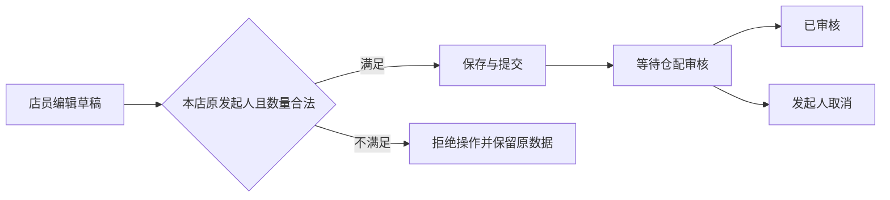
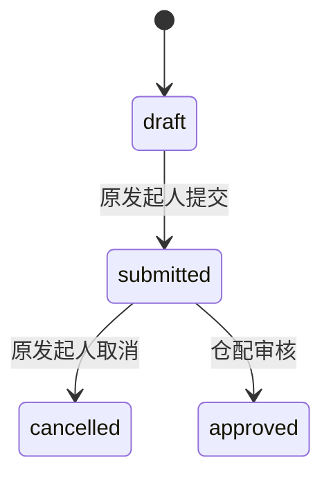

# 库存申请：提交、取消与复制

店员为本店申请补货，仓配接续审核。先理解原单的生命周期，再看“复制为新单”改变了什么。

## [现状] 角色与业务对象

样例的 R12 规范要求本店原发起人保存和提交申请。规范是本例的业务输入；本地分支代码不代表真实生产部署。原文见 [R12 业务规范](../../inventory/spec/current.md)。

| 对象或角色 | 业务含义 | 重要边界 |
| --- | --- | --- |
| 店员 | 发起本店补货申请 | 门店归属与发起人必须同时满足 |
| 库存申请 | 一组商品及其申请数量 | 已取消、已审核内容用于审计，不可原地改写 |
| 仓配 | 审核已提交的申请 | 后续真实接口不在本机样例中 |

## [现状] 从草稿到审核

## [现状] 原单的状态流转

图中的审核和取消来自规范；当前本机 Store 只覆盖下述复制、保存、提交路径，不能据此认为仓配联调通过。

## [现状] 规则与例外

| 操作或情况 | 规则 | 例子与依据 |
| --- | --- | --- |
| 保存、提交 | 同时满足本店、原发起人、草稿状态 | [规范](../../inventory/spec/current.md)与[实现](../../inventory/inventory.py) |
| 商品数量 | 1–99 的整数；布尔值不是数量 | 1、99 合法；0、100、true 拒绝 |
| 历史申请 | 已取消、已审核记录不可原地改写 | “重新申请”必须区分新单与原单 |
| 跨店代操作 | 尚无批准的授权决定 | 继续拒绝，不能从复制功能推导扩大权限 |
| 保存失败 | 原有内容保持不变，修正后再试 | 本机断言核对拒绝与恢复路径 |

## [拟议变更] 复制已取消申请

关联任务：[产品决定 D17](../../inventory/docs/copy-decision.md)。下一版增加复制：原发起人将本店 cancelled 申请复制成独立 draft，新单保留 `copied_from`；原单及其商品内容保持不变。R13 尚未部署。

## [实测结果] 本机复制、回读与重提

保留的[11 项测试](../../inventory/tests/test_inventory.py)及[实际输出](../../inventory/docs/evidence/copy-cancelled-02.json.output.txt)覆盖了复制→改量→保存→回读→提交，以及权限拒绝、历史状态保护、数量边界和引用隔离。

验证对象是进程内 Store，不是磁盘重启持久化；真实接口、仓配后续、UAT 和生产仍未验证。当前实现与这些限制均可从[任务卡的验证与交接](../../inventory/docs/copy-decision.md#验证与交接)继续查阅。
