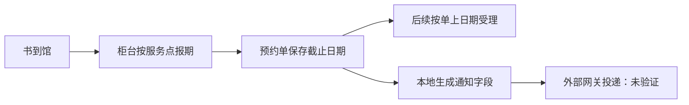

# 预约自取：期限与存量单

书到馆后，柜台确定预约人的自取截止日期。单据一旦保存，后续受理与通知应沿用单上的日期。

## [现状] 样例中的 R12 口径

[门店使用说明](../../library/handbook.md)规定普通分馆保留两个自然日、临时服务点保留一个自然日。这是样例提供的现行政策，不是本次核验过的真实上线记录。

## [现状] 哪些规则持续成立

| 情况 | 业务规则 | 为什么重要 |
| --- | --- | --- |
| 已有预约单 | 沿用单上已保存的日期 | 调整新单政策不应改写旧承诺 |
| 临时服务点 | 仍为一个自然日 | 延长普通分馆的改动不能扩散到特殊点 |
| 跨月 | 按自然日计算 | 2 月 28 日加一天是 3 月 1 日 |
| 日终通知 | 从已保存单据读日期 | 柜台、单据和通知应使用同一口径 |

## [拟议变更] 普通分馆新单延长一天

[任务卡：普通分馆新预约延长一天](../../library/docs/changes/regular-holds.md)把普通新单改为三天；临时点和存量单维持原口径。当前代码是待发布实现，不能用其三天计算覆盖上面的 R12 政策说明。

## [实测结果] SQLite 重开与防回退

已有[回归测试](../../library/test_collection.py)和[跨进程重放输出](../../evidence/second-projects-replay.output.txt)核对了以下结果：

| 单据 | 到馆日期 | 重开数据库后的截止日期 | 通知 collect_by |
| --- | --- | --- | --- |
| 普通新单 | 2026-02-28 | 2026-03-03 | 2026-03-03 |
| 临时点新单 | 2026-02-28 | 2026-03-01 | 2026-03-01 |
| R12 存量单 | 沿用原单 | 2026-03-02 | 2026-03-02 |

重放还故意将临时点改为两天，确认两项测试失败；恢复后重新通过。这是可重复的反例，不证明此前独立会话发生过同一过程。真实网关投递、目标环境与启用范围仍待核验。

实现依据：[collection.py](../../library/collection.py)。
