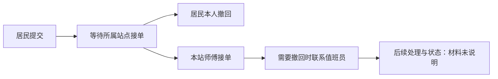

# 维修工单：归属与撤回

居民向代管点提交维修需求，由所属站点师傅接单。理解这项业务需要分清“谁的工单”和“哪个站点的工单”。

## [现状] 值班手册规定的办理路径

[现行值班手册](../../repairclub/desk-policy.md)允许居民撤回自己的待接单工单；接单后应联系值班员处理。代管点只受理本站工单。

## [现状] 权限、状态与例外

| 操作 | 谁可以做 | 条件或例外 |
| --- | --- | --- |
| 提交 | 居民 | 同时记录提交人和所属站点 |
| 接单 | 所属站点师傅 | 仅待接单；跨站和重复接单拒绝 |
| 待接单时撤回 | 提交人 | 非本人拒绝；撤回后不可再接单 |
| 已接单后要求撤回 | 提交人联系值班员 | 手册没有给出值班员的具体操作和结束状态 |

## [实测结果] 代码与手册存在差异

[orders.py](../../repairclub/orders.py)实际上允许本人直接将已接单工单改成 cancelled，本地过程没有值班员参与。[重放输出](../../evidence/second-projects-replay.output.txt)确认了这一行为，也确认跨站、非本人、重复操作被拒后原对象不变。

这说明本地实现和手册口径不一致，不意味着手册已变更，也不证明线上居民入口具有相同能力。角色和站点参数本身不能证明真实身份认证。

## [拟议变更] 差异仍待业务决定

当前材料没有批准具体修复方案。需要明确是补充值班员流程、收紧当前撤回实现，还是调整政策；本文保留这个问题，不自动选择产品规则。

## 调查边界与依据

仅有提交、接单、撤回的本地资料。维修执行、转派、结案及持久化、线上入口尚未核验或缺少材料，不能把三个状态看作完整维修生命周期。

原有[业务说明](../../repairclub/README.md)保留了政策、代码和本地观察的对应关系。本例尚无已关联任务记录，后续有明确工作项时通过普通 Markdown 链接关联即可。
