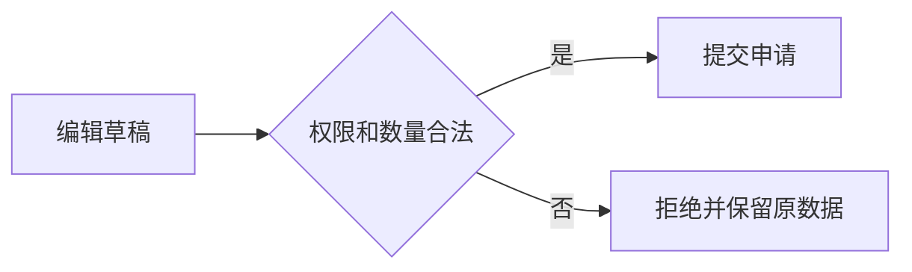

# 直接读取 Markdown 的业务阅读页

需要网页导航、业务查询、图表或任务卡跳转时读取。阅读器是一套通用界面；项目业务内容仍只有原有 Markdown，刷新时重新读取，不生成另一份业务 HTML、模型或索引库。

## 启动

需要 Python 3.9+，浏览器资源随技能分发，不需要 Node 或运行时外网。

```bash
python3 <技能目录>/scripts/reader.py --project /path/to/project \
  --entry docs/business/index.md --tasks docs/changes --port 8765
```

从终端打印的本机 URL 打开。服务只读且只监听 `127.0.0.1`；结束阅读后关闭进程即可。`--entry` 指向项目已有业务入口，可以位于 `.moluoxixi/`、`.trellis/` 等规范目录。`--tasks` 可重复指定任务目录或单个 Markdown；没有该参数时，仅在存在时使用 `docs/changes/`。这里的任务卡是已有工作记录的阅读视图，不增加领取、完成或执行状态机。

入口及其普通 Markdown 链接组织业务导航。业务页、任务页之间的链接定义关联，阅读器据此提供跳转和反向查阅；已引用的代码、日志等安全文本可在来源视图核对。项目外路径、凭据来源及未收录文件不会作为本机文件暴露。

## 用常见 Markdown 表达内容

- 标题与普通链接组织模块和导航，表格写规则、权限、例外及来源。
- `mermaid` 代码块表达流程、状态和关系；图也是 Markdown 内容，修改原文后刷新即可。
- 在标题开头显式写 `[现状]`、`[拟议变更]` 或 `[实测结果]`，区分结论用途；子章节继承父章节标记。未标记内容按原文显示，不自动归类成现状或通过。
- 普通相对链接连接业务和任务记录；无需关系配置文件。页内锚点与浏览器返回可用于继续阅读。

````markdown
# 库存申请

## [现状] 提交申请
本店原发起人提交补货申请，数量必须为 1–99 的整数。[规范](../spec/inventory.md)



## [拟议变更] 复制已取消申请
下一版增加复制为新草稿，保留原单。[关联任务卡](../changes/copy.md)

## [实测结果] 本机保存与回读
写明实际代码、环境、断言、结果和未覆盖范围。[原始输出](../changes/evidence/copy.output.txt)
````

任务记录也可用 `[业务说明](../business/inventory.md)` 链回业务。即使只在业务页写了任务链接，任务页仍能从反向关联回到业务；关联不改写任何源文件。

## 阅读和核对

业务查询先定位业务或规则，再沿相关任务查看本次差异和验证依据。查看原文可直接核对当前 Markdown；来源文件不存在、图表语法错误或读取失败时保留清楚的错误状态，不能用旧内容冒充当前加载成功。修改 Markdown 后刷新内容，不需要重建网页。

标题标记只表明作者如何组织原文，不能证明来源真实、规则生效或验收通过。继续按[业务说明](business.md)维护适用范围，并按[验证与证据](verification.md)核对实际断言。纯问答可以直接解释；小任务不要求为了网页新建整套文档。
